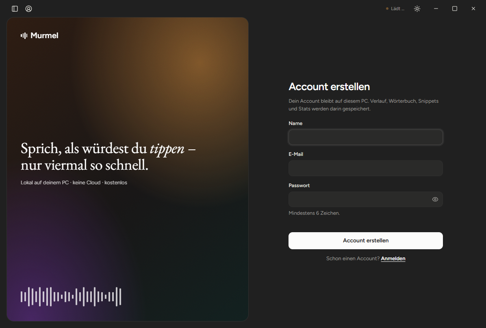
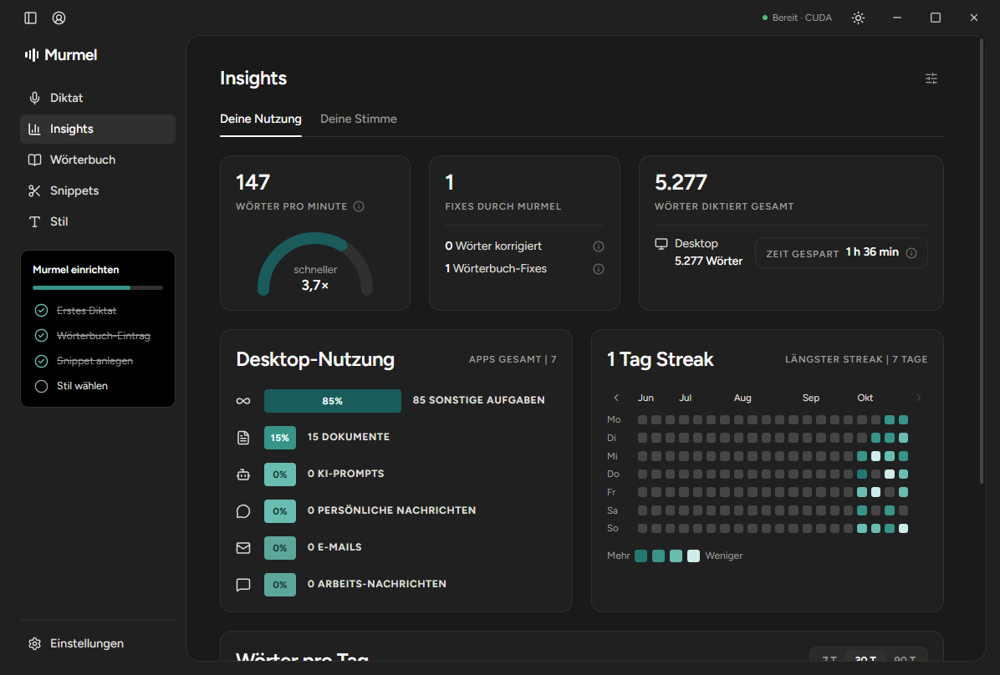
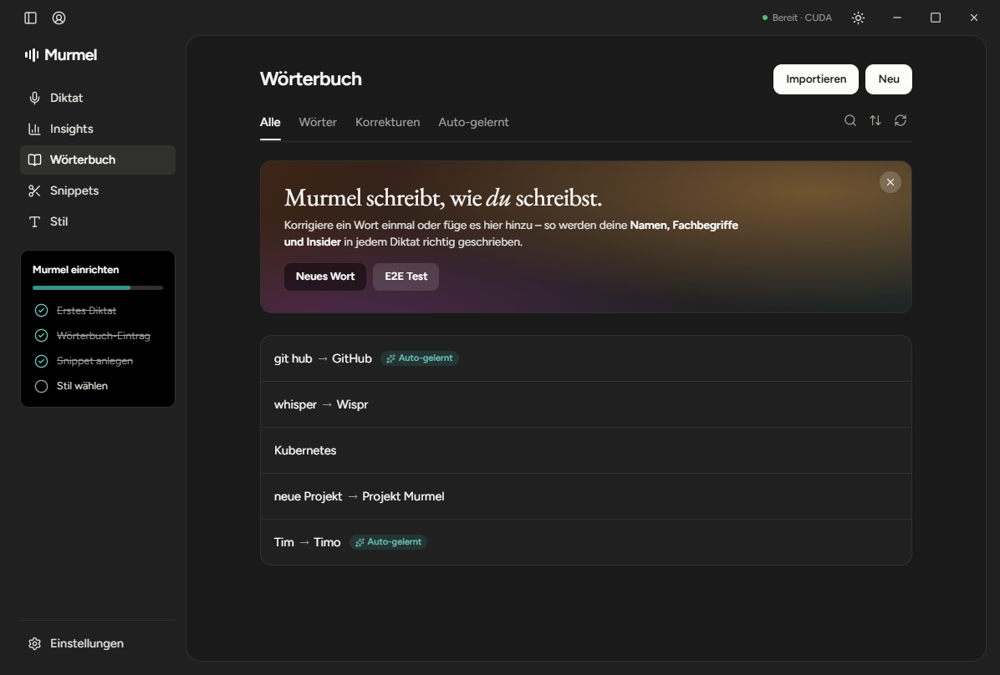
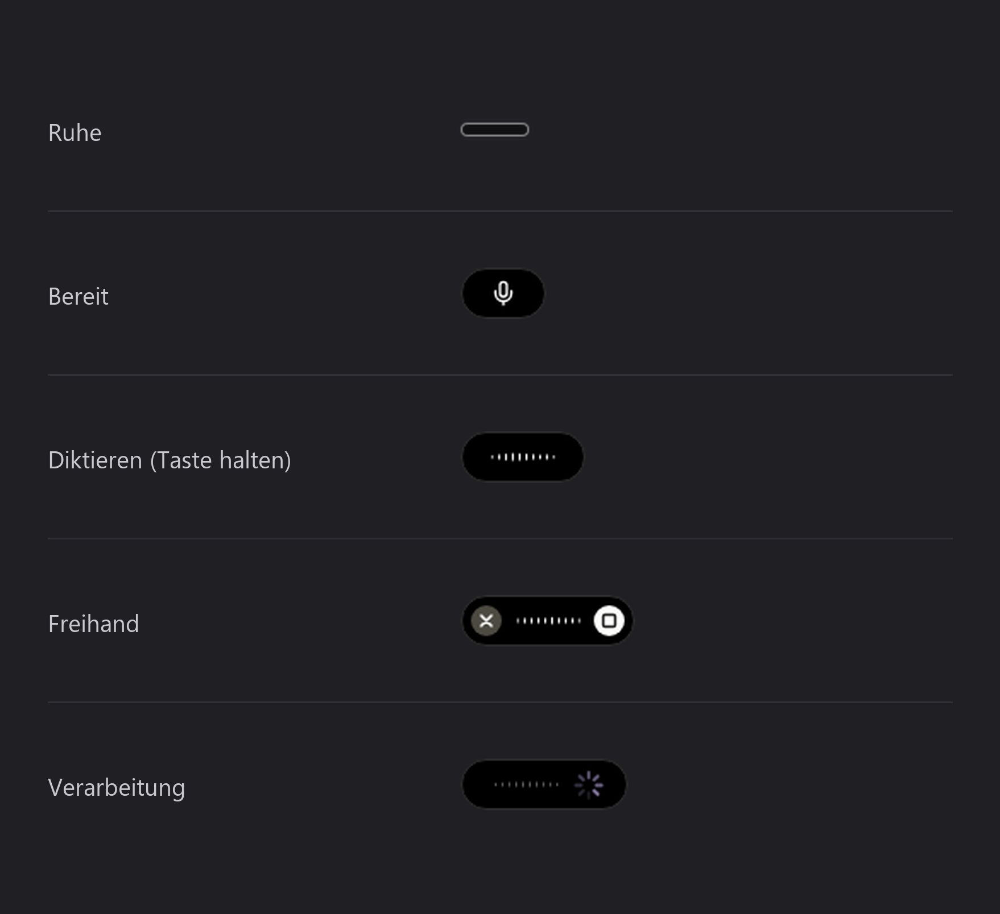

<div align="center">


# Murmel

**Diktieren statt tippen – lokal, schnell und kostenlos.**

Eine kostenlose Alternative zu [Wispr Flow](https://wisprflow.ai/) für Windows.
Taste halten, sprechen, loslassen – der Text landet dort, wo dein Cursor gerade steht.

[](#installation)
[](LICENSE)
[](https://www.python.org/)
[](https://www.electronjs.org/)

[**Download**](https://github.com/Voidlesh/Murmel/releases/latest) · [Installation](#installation) · [Bedienung](#bedienung) · [Datenschutz](#datenschutz)

</div>

Murmel ist ein Klon von Wispr Flow mit demselben Workflow, aber ohne Abo und ohne Cloud. Die Spracherkennung läuft auf deinem eigenen Rechner, nach dem einmaligen Modell-Download brauchst du kein Internet.

> Murmel ist ein unabhängiges Open-Source-Projekt und steht in keiner Verbindung zu Wispr Flow.

## Highlights

- **Kostenlos:** keine Konten bei Drittanbietern, keine Abos, keine Limits.
- **Lokal:** deine Stimme verlässt deinen PC nicht.
- **Schnell:** [faster-whisper](https://github.com/SYSTRAN/faster-whisper) hält das Modell auf der NVIDIA-GPU (CUDA) warm. Ein kurzer Satz ist meist nach etwa einer Sekunde eingefügt.
- **Überall:** Murmel schreibt in das Fenster, das gerade aktiv ist – Browser, Mail, Editor, Chat, Textverarbeitung.

## Funktionen

- **Diktieren per Taste:** Diktier-Taste (Standard: *Caps Lock*) halten, sprechen, loslassen.
- **Freihand-Modus:** Taste kurz antippen für dauerhafte Aufnahme, erneut tippen beendet sie.
- **Automatische Bereinigung:** Füllwörter wie „äh“ werden entfernt.
- **Sprachbefehle:** „neue Zeile“ und „neuer Absatz“ werden als Formatierung umgesetzt.
- **Wörterbuch und Snippets:** eigene Begriffe, Korrekturen und Textbausteine per Kürzel.
- **Stil pro App:** unterschiedliche Tonalität für Chats, Arbeit und E-Mails.
- **Notizen-Aufnahmen:** lange Sitzungen mit Live-Transkript, Notizen und Aufgaben.
- **Insights:** Wörter pro Minute, Streaks, Zeitersparnis und Nutzung nach App.
- **Mehrere Accounts:** Verlauf, Wörterbuch und Statistiken getrennt pro Account.
- **Island-Overlay:** dezentes Status-Element am Bildschirmrand, per Rechtsklick steuerbar.
- **Optionaler KI-Feinschliff:** Umformulierung über einen lokalen [LM Studio](https://lmstudio.ai/)-Server. Standardmäßig aus.

## Screenshots

<table>
  <tr>
    <td></td>
    <td></td>
  </tr>
  <tr>
    <td colspan="2"></td>
  </tr>
</table>

<p align="center">
  
</p>

## Installation

### Download (empfohlen)

1. Die Datei **`Murmel-Setup-x.y.z.exe`** von der [Releases-Seite](https://github.com/Voidlesh/Murmel/releases/latest) herunterladen (ca. 1,3 GB).
2. Den Installer starten. Windows meldet eventuell, dass der Computer geschützt wurde: **Weitere Informationen → Trotzdem ausführen**. Der Installer ist (noch) nicht signiert.
3. Die Installation braucht keine Administratorrechte.
4. Murmel über das Startmenü starten. Das Tray-Icon öffnet die App jederzeit wieder.

Beim ersten Start lädt Murmel das Spracherkennungsmodell (ca. 1,6 GB) herunter. Danach läuft alles lokal.

> Für beste Geschwindigkeit braucht Murmel eine NVIDIA-Grafikkarte mit aktuellem Treiber. Ohne GPU läuft die Erkennung auf dem Prozessor und dauert etwas länger.

<details>
<summary><b>Aus dem Quellcode installieren</b></summary>

**Voraussetzungen:** Windows 10 oder 11 (64 Bit), [Python 3.12](https://www.python.org/downloads/) und [Node.js LTS](https://nodejs.org/).

```powershell
git clone https://github.com/Voidlesh/Murmel.git
cd Murmel

py -3.12 -m venv .venv
.venv\Scripts\python.exe -m pip install --upgrade pip
.venv\Scripts\python.exe -m pip install -r requirements.txt

cd app
npm install
cd ..
```

Optional legt `scripts\install_shortcut.ps1` eine Verknüpfung auf dem Desktop und im Startmenü an. Gestartet wird Murmel über `Murmel.vbs` (ohne Konsolenfenster).

</details>

## Bedienung

| Aktion | Wie |
|---|---|
| Diktieren | Diktier-Taste gedrückt halten, sprechen, loslassen |
| Freihand-Diktat | Taste kurz antippen, zum Beenden erneut antippen oder ■ im Island klicken |
| Abbrechen | `Esc` oder ✕ im Island |
| Island-Menü | Rechtsklick auf die Island: Diktat, Notizen, ausblenden, Position, Einstellungen |
| Tray-Menü | Rechtsklick auf das Tray-Icon: Island, Position, Autostart, Einstellungen |
| Taskleisten-Menü | Rechtsklick auf das Taskleisten-Icon: Diktat, Notizen, Island, Einstellungen |

Alle Einstellungen findest du im Dashboard unter **Einstellungen**. Sie werden pro Account gespeichert.

<details>
<summary><b>Wichtige Optionen</b></summary>

| Option | Standard | Bedeutung |
|---|---|---|
| `hotkey` | `caps lock` | Diktier-Taste |
| `language` | `de` | Sprache der Spracherkennung |
| `model` | `large-v3-turbo` | Whisper-Modell (`tiny` bis `large-v3`) |
| `device` | `auto` | `auto`, `cuda` oder `cpu` |
| `remove_fillers` | `true` | Füllwörter entfernen |
| `duck_audio` | `true` | Systemlautstärke beim Diktieren absenken |
| `llm.enabled` | `false` | KI-Feinschliff über LM Studio |
| `llm.base_url` | `http://localhost:1234/v1` | Adresse des LM-Studio-Servers |

</details>

## Datenschutz

- **Audio und Text bleiben auf deinem PC.** Die Spracherkennung läuft lokal.
- **Accounts sind lokal.** Passwörter werden mit scrypt gehasht.
- **Daten liegen unter** `%APPDATA%\Murmel\accounts\<id>\`. Du kannst den Ordner jederzeit löschen oder sichern.
- **Netzwerkzugriffe** gibt es nur für den einmaligen Modell-Download von Hugging Face und, falls aktiviert, für deinen lokalen LM-Studio-Server.

## Fehlerbehebung

| Problem | Lösung |
|---|---|
| Status zeigt „Bereit · CPU“ statt „CUDA“ | NVIDIA-Treiber aktualisieren. Bei Quellcode-Installation die `nvidia-*`-Pakete installieren. |
| Diktier-Taste reagiert nicht | Prüfen, ob eine andere Anwendung dieselbe Taste belegt, etwa Wispr Flow. |
| Fehler bei der Spracherkennung | `%APPDATA%\Murmel\engine.log` öffnen und den Eintrag in einem [Issue](https://github.com/Voidlesh/Murmel/issues) beilegen. |

## Entwicklung

<details>
<summary><b>Tests, Aufbau und Start für Entwickler</b></summary>

Murmel besteht aus zwei Teilen, die über einen lokalen WebSocket (`127.0.0.1:47821`) sprechen:

- `engine/`: Python-Backend mit Hotkey, Aufnahme, Whisper, Text-Pipeline, SQLite und Accounts
- `app/`: Electron-Oberfläche mit Dashboard und Island-Overlay

```powershell
# Unit-Tests
.venv\Scripts\python.exe -m pytest tests

# Oberfläche direkt auf einer Seite öffnen
cd app
npx electron . --page=insights --tab=voice
```

Die End-to-End-Skripte in `tests/` (`e2e_engine.py`, `e2e_hotkey.py`) setzen eine laufende Engine voraus.

</details>

## Mitwirken

Beiträge sind willkommen: Fehlerberichte, Ideen und Pull Requests. Details stehen in [CONTRIBUTING.md](CONTRIBUTING.md).

## Lizenz

Murmel steht unter der [MIT-Lizenz](LICENSE).

## Danksagung

Murmel baut auf [faster-whisper](https://github.com/SYSTRAN/faster-whisper), [OpenAI Whisper](https://github.com/openai/whisper), [CTranslate2](https://github.com/OpenNMT/CTranslate2), [Electron](https://www.electronjs.org/) und weiteren Open-Source-Projekten auf. Die vollständige Liste steht in den Abhängigkeiten von `requirements.txt` und `app/package.json`. Funktionsumfang und Bedienung orientieren sich an [Wispr Flow](https://wisprflow.ai/).

Schriften und Icons kommen von [Fontsource](https://fontsource.org/) (Figtree, EB Garamond) und [Lucide](https://lucide.dev/). Hintergrundfotos stammen von [Unsplash](https://unsplash.com/license).
